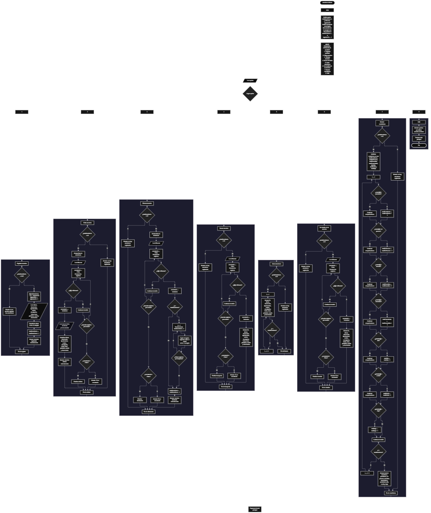

Este proyecto, llamado <b>atencion al cliente</b>, fue desarrollado en <b>pseint</b> como un ejercicio práctico para fortalecer la lógica de programación mediante la creación de un sistema de gestión de atenciones desde la consola. El programa cuenta con un menú principal de ocho opciones que permite <b>registrar, editar, eliminar, buscar, listar y consultar la información completa</b> de las atenciones registradas, además de mostrar estadísticas sobre su estado y prioridad. Cada atención almacena datos como el nombre del cliente, el documento, el tipo de atención, el motivo, la descripción, la fecha, la hora, la prioridad, el estado y las observaciones, utilizando arreglos con una capacidad máxima de <b>100 atenciones durante la ejecución</b>. Durante su desarrollo se aplicaron conceptos fundamentales de programación, como variables, arreglos, estructuras condicionales, ciclos repetitivos y estructuras de selección, además de procesos para buscar, modificar, eliminar y organizar registros. Este proyecto permite poner en práctica los conocimientos adquiridos en PSeInt y sirve como base para desarrollar sistemas de gestión de atenciones más avanzados utilizando otros lenguajes y tecnologías.

<h2 align="center">⚙️ Funcionamiento del menú principal</h2>

### ➕ Registrar atención

La opción <b>1) registrar atención</b> permite registrar una nueva atención al cliente. Antes de realizar el registro, el sistema comprueba que la cantidad de atenciones almacenadas sea menor a <b>100</b>, utilizando la condición <b>totalAtenciones &lt; 100</b>. Si existe espacio disponible, el programa asigna un identificador mediante la variable <b>siguienteID</b> y aumenta su valor en uno para preparar el siguiente identificador. Después, solicita el <b>nombre del cliente, documento, tipo de atención, motivo, descripción, fecha, hora, prioridad, estado y observación</b>. Los datos se almacenan en la siguiente posición disponible de sus respectivos arreglos. Finalmente, aumenta la variable <b>totalAtenciones</b> en uno y muestra el mensaje <b>"atencion al cliente registrada correctamente."</b>. Si la capacidad máxima se alcanza, presenta el mensaje <b>"no se pueden registrar mas atenciones."</b>, impidiendo registrar otra atención.

### ✏️ Editar atención

La opción <b>2) editar atención</b> permite modificar la información de una atención registrada. Primero, el programa comprueba si existen atenciones almacenadas mediante la variable <b>totalAtenciones</b>. Si no hay registros, muestra el mensaje <b>"no hay atenciones registradas."</b>. En caso contrario, presenta una lista con el identificador, el cliente, el documento, el tipo de atención, el motivo, la descripción, la fecha, la hora, la prioridad, el estado y la observación de cada registro. Después, solicita el identificador de la atención que se desea editar mediante la variable <b>idBuscar</b> e inicializa la variable lógica <b>encontrado</b> con el valor <b>falso</b>. A continuación, utiliza un ciclo <b>para</b> para recorrer los identificadores almacenados y compararlos con el valor introducido. Cuando encuentra una coincidencia, cambia la variable <b>encontrado</b> a <b>verdadero</b> y solicita los nuevos datos del cliente y de la atención, actualizando directamente los arreglos correspondientes sin modificar el identificador. Finalmente, muestra el mensaje <b>"atencion al cliente editada correctamente."</b>. Si el identificador no corresponde a ninguna atención registrada, presenta el mensaje <b>"no se encontro una atencion con ese id."</b>.

### 🗑️ Eliminar atención

La opción <b>3) eliminar atención</b> permite eliminar una atención registrada mediante su identificador. Antes de comenzar, el programa comprueba que existan atenciones almacenadas. Si no hay registros, muestra el mensaje <b>"no hay atenciones registradas."</b>. Si existen atenciones, presenta una lista con sus datos y solicita el identificador que se desea eliminar. Después, inicializa la variable <b>encontrado</b> con el valor <b>falso</b> y recorre los registros mediante un ciclo <b>para</b>. Cuando encuentra una coincidencia, cambia la variable a <b>verdadero</b>. Si la atención seleccionada no ocupa la última posición, utiliza otro ciclo <b>para</b>, controlado por la variable <b>j</b>, para desplazar una posición hacia atrás los datos de las atenciones posteriores en los arreglos <b>id, cliente, documento, tipoAtencion, motivo, descripcion, fecha, hora, prioridad, estado y observacion</b>. Posteriormente, disminuye la variable <b>totalAtenciones</b> en uno y muestra el mensaje <b>"atencion al cliente eliminada correctamente."</b>. Si el identificador no se encuentra, presenta el mensaje <b>"no se encontro una atencion con ese id."</b>. En el código actual, no se limpia expresamente la última posición después del desplazamiento y el contador se modifica dentro del ciclo que busca la atención.

### 🔎 Buscar atención

La opción <b>4) buscar atención</b> permite localizar una atención mediante su identificador. Primero, el programa comprueba si existen registros. Si no hay atenciones almacenadas, muestra el mensaje <b>"no hay atenciones registradas."</b>. En caso contrario, solicita el identificador de la atención mediante la variable <b>idBuscar</b>, inicializa <b>encontrado</b> con el valor <b>falso</b> y utiliza un ciclo <b>para</b> para recorrer los identificadores almacenados. Cuando encuentra una coincidencia, cambia la variable a <b>verdadero</b> y muestra los datos encontrados: identificador, cliente, documento, tipo de atención, motivo, descripción, fecha, hora, prioridad, estado y observación. Si finaliza el recorrido sin encontrar coincidencias, presenta el mensaje <b>"no se encontro una atencion con ese id."</b>. La búsqueda se realiza mediante el identificador asignado a cada atención durante su registro.

### 📋 Listar atenciones

La opción <b>5) listar atenciones</b> permite visualizar todas las atenciones registradas en el sistema. Antes de mostrar la información, el programa comprueba si la variable <b>totalAtenciones</b> es igual a cero. Si no existen registros, presenta el mensaje <b>"no hay atenciones registradas."</b>. Si hay atenciones disponibles, muestra el encabezado <b>"atenciones registrados"</b> y utiliza un ciclo <b>para</b> para recorrer los arreglos desde la primera posición hasta el total de atenciones registradas. Durante el recorrido, presenta el identificador, el cliente, el documento, el tipo de atención, el motivo, la descripción, la fecha, la hora, la prioridad, el estado y la observación de cada registro. Esta función facilita la consulta general de las atenciones almacenadas sin necesidad de buscar cada registro individualmente.

### 📄 Ver detalles de la atención

La opción <b>6) ver detalles de la atención</b> permite consultar la información completa de una atención específica. Primero, el programa comprueba si existen atenciones registradas. Si no hay registros, muestra el mensaje <b>"no hay atenciones registradas."</b>. En caso contrario, solicita el identificador de la atención mediante la variable <b>idBuscar</b> e inicializa la variable lógica <b>encontrado</b> con el valor <b>falso</b>. Después, utiliza un ciclo <b>para</b> para recorrer los registros y comparar sus identificadores con el valor introducido. Cuando encuentra una coincidencia, cambia la variable a <b>verdadero</b> y muestra el identificador, el cliente, el documento, el tipo de atención, el motivo, la descripción, la fecha, la hora, la prioridad, el estado y la observación. Si el identificador no corresponde a una atención registrada, presenta el mensaje <b>"no se encontro una atencion con ese id."</b>. Esta función permite consultar los datos completos de una atención sin modificar su información.

### 📊 Mostrar estadísticas

La opción <b>7) mostrar estadísticas</b> permite conocer la cantidad de atenciones registradas según su estado y prioridad. Primero, el programa comprueba si existen atenciones almacenadas. Si no hay registros, muestra el mensaje <b>"no hay atenciones registradas."</b>. Si existen, inicializa en cero los contadores <b>totalPendientes, totalEnProceso, totalResueltas, totalCanceladas, totalAlta, totalMedia y totalBaja</b>. Después, utiliza un ciclo <b>para</b> para recorrer los registros y comparar el estado y la prioridad de cada atención con los valores establecidos en las condiciones. Si el estado es <b>"pendiente"</b>, aumenta el contador de pendientes; si es <b>"en proceso"</b>, aumenta el contador de atenciones en proceso; si es <b>"resuelto"</b>, aumenta el contador de resueltas; y si es <b>"cancelado"</b>, aumenta el contador de canceladas. De manera similar, clasifica las prioridades <b>"alta"</b>, <b>"media"</b> y <b>"baja"</b>. Finalmente, muestra el total de atenciones y las cantidades correspondientes a cada estado y prioridad. Estas estadísticas dependen de que los datos ingresados coincidan exactamente con las cadenas utilizadas en las comparaciones.

### 🚪 Salir del menú principal

La opción <b>8) salir</b> permite finalizar la ejecución del programa y muestra el mensaje <b>"gracias por utilizar atencion al cliente."</b>. El menú principal se encuentra dentro de una estructura repetitiva <b>repetir ... hasta que</b>, que mantiene el programa en funcionamiento mientras el usuario realiza las operaciones disponibles. En el código actual, la condición final es <b>hasta que opcion = 8</b>, por lo que seleccionar la opción 8 termina el ciclo y permite finalizar el programa. Si se introduce un valor que no coincide con ninguna de las opciones disponibles, la estructura <b>de otro modo</b> muestra el mensaje <b>"opcion no valida."</b>.

<h2 align="center">🧠 Temas aplicados en el proyecto</h2>

### 📦 Variables

En este proyecto se utilizan variables para almacenar la opción seleccionada en el menú, controlar la cantidad de atenciones registradas, recorrer los arreglos, buscar identificadores, generar nuevos números de identificación y contabilizar las atenciones según su estado y prioridad. Cada variable cumple una función específica dentro de las operaciones de gestión.

🔢 **Opcion:** Almacena la opción seleccionada por el usuario en el menú principal.

📊 **TotalAtenciones:** Almacena la cantidad actual de atenciones registradas.

🔄 **I:** Funciona como contador en los ciclos <b>para</b> y permite recorrer los arreglos.

🔁 **J:** Controla el recorrido utilizado para desplazar los datos durante la eliminación de una atención.

🔎 **IdBuscar:** Almacena el identificador introducido por el usuario para buscar, editar, eliminar o consultar una atención.

🆔 **SiguienteID:** Genera el identificador de cada nueva atención y aumenta después de su asignación.

✅ **Encontrado:** Variable lógica que indica si se encontró una atención con el identificador solicitado.

📈 **TotalPendientes, TotalEnProceso, TotalResueltas y TotalCanceladas:** Almacenan las cantidades de atenciones clasificadas según su estado.

🚦 **TotalAlta, TotalMedia y TotalBaja:** Almacenan las cantidades de atenciones clasificadas según su prioridad.

### 🗃️ Arreglos

En este proyecto se utilizan once arreglos relacionados con los datos de cada atención. Cada arreglo tiene una capacidad de <b>100 posiciones</b> y utiliza el mismo índice para representar la información correspondiente a un mismo registro. Por ejemplo, los datos de una atención almacenada en la posición <b>1</b> se encuentran distribuidos entre <b>id[1], cliente[1], documento[1], tipoAtencion[1], motivo[1], descripcion[1], fecha[1], hora[1], prioridad[1], estado[1] y observacion[1]</b>. Esta organización permite recorrer, buscar, modificar, mostrar y eliminar las atenciones de manera ordenada.

🆔 **Id[100]:** Almacena los identificadores de las atenciones.

👤 **Cliente[100]:** Almacena los nombres de los clientes.

🪪 **Documento[100]:** Almacena los documentos de los clientes.

📂 **TipoAtencion[100]:** Almacena el tipo de atención registrada.

📝 **Motivo[100]:** Almacena el motivo de cada atención.

📄 **Descripcion[100]:** Almacena la descripción de la atención.

📅 **Fecha[100]:** Almacena la fecha de atención.

🕒 **Hora[100]:** Almacena la hora de atención.

🚦 **Prioridad[100]:** Almacena la prioridad de cada registro.

📌 **Estado[100]:** Almacena el estado de cada atención.

💬 **Observacion[100]:** Almacena las observaciones adicionales.

### 🔀 Estructuras condicionales

En este proyecto se utilizan las estructuras <b>si</b> y <b>sino</b> para comprobar si existe espacio disponible antes de registrar una atención, verificar si hay registros antes de ejecutar determinadas operaciones, identificar coincidencias entre los identificadores y clasificar las atenciones según su estado y prioridad. Estas condiciones permiten que el programa ejecute diferentes instrucciones según la situación encontrada durante cada operación.

### 🔄 Estructuras repetitivas

En este proyecto se utilizan los ciclos <b>para</b> y <b>repetir ... hasta que</b>. Los ciclos <b>para</b> permiten recorrer los arreglos para mostrar las atenciones, buscar identificadores, modificar registros, consultar detalles y calcular estadísticas. Durante la eliminación, también se utilizan para desplazar los datos de las atenciones posteriores una posición hacia atrás. Por otro lado, el ciclo <b>repetir ... hasta que</b> mantiene activo el menú principal para que el usuario pueda ejecutar las diferentes operaciones antes de salir del programa mediante la opción 8.

### 🎯 Estructura según

El programa evalúa el valor almacenado en la variable <b>opcion</b> y ejecuta el bloque de instrucciones correspondiente mediante la estructura <b>segun</b>. Cada caso representa una operación específica del sistema: <b>registrar, editar, eliminar, buscar, listar, ver detalles, mostrar estadísticas o salir</b>. También se utiliza el bloque <b>de otro modo</b> para mostrar el mensaje <b>"opcion no valida."</b> cuando el usuario introduce un número que no coincide con ninguna de las opciones definidas en el menú.

### 🔢 Dimensionamiento de arreglos

El programa utiliza la instrucción <b>dimension</b> para establecer la capacidad de los arreglos que almacenan la información de las atenciones. Se definieron <b>100 posiciones</b> para cada arreglo, lo que permite administrar hasta 100 atenciones durante la ejecución. La cantidad de registros activos se controla mediante la variable <b>totalAtenciones</b>, por lo que las operaciones recorren las posiciones comprendidas entre la primera y el total actual de atenciones.

<h2 align="center">¿Cómo se implementaron las operaciones crud en el proyecto?</h2>

Las operaciones <b>crud</b> se implementaron mediante las opciones del menú principal, permitiendo administrar las atenciones registradas. La operación <b>crear</b> corresponde a <b>registrar atención</b>, donde se introducen los datos de un nuevo registro; <b>leer</b> se realiza mediante las opciones <b>buscar atención, listar atenciones y ver detalles de la atención</b>; <b>actualizar</b> corresponde a <b>editar atención</b>, donde se modifican los datos de una atención existente; y <b>eliminar</b> se realiza mediante la opción <b>eliminar atención</b>. Estas operaciones utilizan variables, arreglos, estructuras condicionales y ciclos para administrar la información almacenada temporalmente durante la ejecución del programa.

<h2 align="center">Diagrama de flujo del proyecto</h2>

<h2 align="center">🛡️ Validaciones del programa</h2>

### 📭 No existen atenciones registradas

Esta comprobación se utiliza en las opciones de <b>editar, eliminar, buscar, listar, ver detalles y mostrar estadísticas</b>. El programa comprueba si la variable <b>totalAtenciones</b> es igual a <b>0</b> y, si no existen atenciones registradas, muestra el mensaje <b>"no hay atenciones registradas."</b>. Esta comprobación evita continuar con las operaciones que necesitan información almacenada cuando la lista de atenciones está vacía.

### ⚠️ Capacidad máxima alcanzada

Esta comprobación se utiliza durante el registro de nuevas atenciones para controlar la capacidad máxima de los arreglos. El programa comprueba si <b>totalAtenciones &gt;= 100</b> antes de permitir registrar otra atención. Si todavía existe espacio disponible, asigna un identificador y solicita los datos del nuevo registro. En caso contrario, muestra el mensaje <b>"no se pueden registrar mas atenciones."</b>, impidiendo agregar más atenciones cuando se alcanza el límite establecido.

### ❌ Atención no encontrada

Esta comprobación se utiliza en las operaciones de edición, eliminación, búsqueda y consulta de detalles. El programa inicializa la variable lógica <b>encontrado</b> con el valor <b>falso</b> y recorre el arreglo <b>id</b> para comparar los identificadores almacenados con el valor introducido por el usuario. Cuando encuentra una coincidencia, cambia la variable a <b>verdadero</b> y ejecuta la operación correspondiente. Si termina el recorrido sin encontrar la atención solicitada, presenta el mensaje <b>"no se encontro una atencion con ese id."</b>.

### ⚠️ Tipo de atención, prioridad y estado

Durante el registro y la edición, el programa solicita el tipo de atención, la prioridad y el estado mediante mensajes que indican los valores esperados. Sin embargo, el código actual no incorpora condiciones que obliguen a introducir exclusivamente las categorías indicadas. Por ello, el usuario puede introducir otros valores, pero estos no serán contabilizados en las estadísticas si no coinciden exactamente con las cadenas utilizadas en las comparaciones.

### 🔢 Opción inválida

La estructura <b>segun</b> incluye el bloque <b>de otro modo</b>, que muestra el mensaje <b>"opcion no valida."</b> cuando el usuario introduce un número que no corresponde a ninguna de las ocho opciones del menú. Después de mostrar el mensaje, el ciclo repetitivo continúa y permite seleccionar otra opción.

<h2 align="center">🎯 Objetivo del proyecto</h2>

El objetivo principal de este proyecto es fortalecer la <b>lógica de programación</b> mediante el desarrollo de un sistema de gestión de atenciones al cliente en <b>pseint</b>. A través de su construcción se busca aplicar los conocimientos adquiridos sobre variables, arreglos, estructuras condicionales, ciclos repetitivos y estructuras de selección, integrándolos para resolver un problema de manera organizada. Además, el proyecto permite comprender cómo registrar, consultar, modificar y eliminar información, así como generar estadísticas mediante contadores que clasifican las atenciones según su estado y prioridad. De esta manera, constituye una base para desarrollar sistemas de gestión más completos utilizando otros lenguajes y tecnologías.

